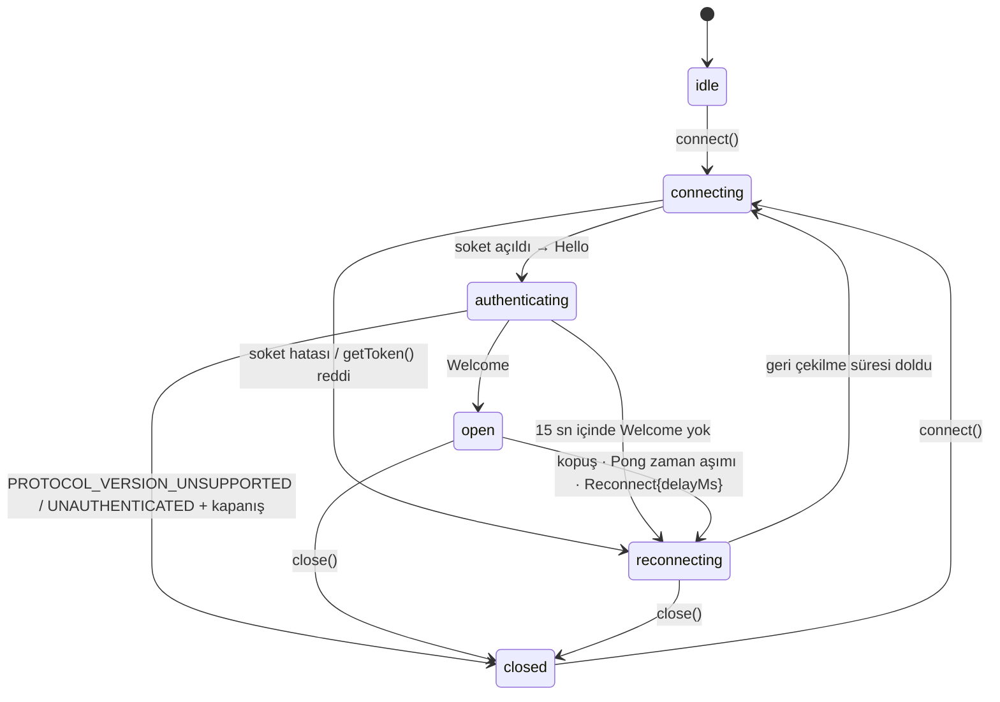

# `@talky/core` — istemci çekirdeği (M0)

`@talky/core`, Talky istemcilerinin ortak çekirdeğidir: React web, Tauri masaüstü ve React Native
uygulamalarının **tamamı** aynı paketi değiştirmeden kullanır. M0'da içeriği gerçek zamanlı
WebSocket istemcisi, kalıcılık/platform sözleşmeleri ve yardımcı ilkellerdir.

Normatif davranış `docs/protocol.md`'dedir; bu belge o kuralların TypeScript tarafındaki
karşılığını, genel API'yi ve test/entegrasyon rehberini anlatır.

## Tasarım kuralları

- **Platformdan bağımsız.** `packages/core/tsconfig.src.json` DOM kütüphanesi ve Node tipleri
  olmadan derler; `window`, `document`, `process`, `Buffer` derleyicide bile yoktur. ESLint ayrıca
  `react`, `react-dom`, `react-native`, `@tauri-apps/*` ve `node:*` içe aktarımlarını yasaklar.
- **Sıfır çalışma zamanı bağımlılığı** — yalnızca `@bufbuild/protobuf` ve `@talky/protocol`.
- **Enjekte edilebilir dikişler.** Saat (`TimerHost`), taşıma (`WebSocketFactory`), rastgelelik
  (`random`), kalıcılık (`Storage`) ve günlükleme (`Logger`) dışarıdan verilir. Testler bu sayede
  gerçek zaman beklemeden, gerçek soket açmadan tüm durum makinesini sürer.
- **Olay dinleyicileri asla soket döngüsünü kıramaz.** Bir dinleyici hata fırlatırsa `error`
  olayına `reason: 'handler'` ile dönüştürülür; bağlantı etkilenmez.
- **ESM, tree-shakeable.** `sideEffects: false`, adlandırılmış dışa aktarımlar, varsayılan dışa
  aktarım yok. Paket kaynak TypeScript olarak yayımlanır (`exports: { ".": "./src/index.ts" }`),
  `@talky/protocol` ile aynı yaklaşım.

## Hızlı başlangıç

```ts
import { createWsClient } from '@talky/core';

const client = createWsClient({
  url: 'wss://talky.local/api/v1/ws',
  getToken: async () => session.accessToken, // her bağlantı denemesinde yeniden okunur
  deviceId, // kurulum başına sabit UUID
  client: { platform: 'web', appVersion: '0.1.0', os: 'Windows 11', locale: 'tr-TR' },
  getSince: () => store.lastAppliedSeqByConversation(), // en fazla 50 giriş gönderilir
});

client.on('open', () => ui.setConnected(true));
client.on('stateChange', (state) => ui.setConnectionState(state));
client.on('resyncRequired', (resync) => void sync.backfill(resync));
client.on('error', (error) => log.warn('ws', { reason: error.reason, code: error.code }));

client.connect();
// ...
client.close('logout'); // Bye gönderir, 1000 ile kapatır, yeniden bağlanmayı devre dışı bırakır
```

## Genel API

### `createWsClient(options): WsClient`

| Seçenek | Varsayılan | Anlamı |
| --- | --- | --- |
| `url` | — | `ws://` / `wss://` uç noktası. |
| `getToken()` | — | `Hello.token`. **Her** denemede çağrılır; yenilenen token otomatik kullanılır. |
| `deviceId` | — | Kurulum başına sabit UUID. |
| `client` | — | `{ platform, appVersion, os, locale }` → `Hello.client`. |
| `protoVersion` | `1` | Konuşulan protokol ana sürümü. |
| `webSocketFactory` | global `WebSocket` | Taşıma dikişi. |
| `timers` | `setTimeout`/`Date.now` | Saat dikişi. |
| `random` | `Math.random` | `[0,1)` düzgün dağılım; jitter, `rid` ve `Reconnect` penceresi buradan. |
| `getSince()` | `{}` | `conversationId → uygulanan son seq`. İlk 50 giriş gönderilir. |
| `logger` | no-op | `debug/info/warn/error`. |
| `requestTimeoutMs` | `15000` | `request()` zaman aşımı; aynı zamanda `Welcome` bekleme süresi. |
| `pongTimeoutMs` | `10000` | `Pong` gelmezse bağlantı ölü sayılır. |
| `backoff` | `{500, 30000, 2, 0.2}` | `initialMs`, `maxMs`, `factor`, `jitter`. |
| `retryOnAuthFailure` | `false` | 1008 sonrası yeniden denemeye devam edilsin mi. |
| `dedupeCapacity` | `2048` | Yerleşik `id` LRU kapasitesi. |

### `WsClient`

| Üye | Açıklama |
| --- | --- |
| `state` | `'idle' \| 'connecting' \| 'authenticating' \| 'open' \| 'reconnecting' \| 'closed'` |
| `rttMs` | Son RTT örneği (ms) ya da `null`. |
| `welcome` | Açık oturumun `Welcome`'ı ya da `null`. |
| `connect()` | Bağlanmaya başlar; `close()` sonrası yeniden bağlanmayı tekrar etkinleştirir. |
| `close(reason?)` | `Bye` gönderir, 1000 ile kapatır, yeniden bağlanmayı kapatır. |
| `send(body)` | Boş `rid` ile ateşle-unut. Oturum açık değilse `TalkyWsError` fırlatır. |
| `request(body, opts?)` | UUIDv7 `rid` atar, eşleşen `Ack` ile çözülür. |
| `on/once/off/listenerCount` | Tipli olay aboneliği; `on` abonelikten çıkma fonksiyonu döndürür. |

`body`, üretilmiş `ClientFrame['body']` birleşiminin dolu yarısıdır:

```ts
import { create } from '@bufbuild/protobuf';
import { PingSchema } from '@talky/protocol/v1';

client.send({ case: 'ping', value: create(PingSchema, { ts: 1n }) });
```

> M0'da protokolde yanıt bekleyen bir gövde henüz yoktur (`SendMessage` M1'de gelir);
> `request()` bugün sahte sunucudaki senaryolarla doğrulanır, mekanizma hazırdır.

### Olaylar

| Olay | Yük | Ne zaman |
| --- | --- | --- |
| `welcome` | `Welcome` | El sıkışma tamamlandı (hemen `open`'dan önce). |
| `open` | — | Oturum kullanılabilir (`state === 'open'`). |
| `frame` | `ServerFrame` | Tekilleştirmeden geçen her sunucu çerçevesi. |
| `stateChange` | `(state, previous)` | Her geçişte. |
| `error` | `TalkyWsError` | Belirli bir isteğe ait olmayan her hata. |
| `resyncRequired` | `ResyncRequired` | Sunucu boşluğu dolduramadı → `GET /api/v1/sync`. |
| `reconnectScheduled` | `{ attempt, delayMs, reason, closeCode }` | Yeniden bağlanma zamanlayıcısı kuruldu. |
| `rtt` | `number` | Yeni RTT örneği. |

### `TalkyWsError`

Tek hata tipi. `reason` alanı üzerinden dallanın, metne bakmayın:

`protocol` (sunucu `Error` çerçevesi ya da çerçeve sözleşmesi ihlali) · `timeout` · `disconnected`
· `closed` · `transport` · `decode` · `heartbeat` (Pong zaman aşımı) · `handler` (uygulama
dinleyicisi fırlattı). Ek alanlar: `code` (`talky.v1.ErrorCode`), `rid`, `retryAfterMs`,
`closeCode`, `cause`.

## Durum makinesi



## El sıkışma

1. Soket açılır açılmaz istemci **ilk çerçeve olarak** `Hello` gönderir. `Hello` bir `rid`
   (UUIDv7) taşır; `since` haritası `getSince()`'ten gelir ve 50 girişte kesilir.
2. `Welcome` gelene kadar durum `authenticating`. `requestTimeoutMs` içinde `Welcome` gelmezse
   `timeout` hatası yayınlanır, soket kapatılır ve geri çekilmeyle yeniden bağlanılır.
3. `Welcome` alındığında `heartbeatIntervalMs` benimsenir (0 ise 25 sn), geri çekilme sayacı
   sıfırlanır, `welcome` ve `open` olayları bu sırayla yayınlanır.

## Canlılık

- İstemci `Welcome.heartbeatIntervalMs` aralığında `Ping{ts}` gönderir; `ts`, `TimerHost.now()`
  değeridir ve `Pong` içinde **aynen** geri beklenir — RTT buradan ölçülür.
- Pencere içinde başka bir çerçeve gönderilmişse `Ping` atlanır (protokol bunu ping sayar).
- `Ping` sonrası `pongTimeoutMs` içinde `Pong` gelmezse bağlantı ölü sayılır: `heartbeat` hatası
  yayınlanır, soket `1000 / "pong-timeout"` ile kapatılır ve geri çekilmeyle yeniden bağlanılır.
- WebSocket protokol ping/pong'u tarayıcı/çalışma zamanı tarafından otomatik yanıtlanır; istemci
  kodu ona dokunmaz.

## Yeniden bağlanma, resume ve kapanış kodları

Geri çekilme: `500 ms → ×2 → 30 s`, ±%20 jitter, `random()` ile üretilir. Sayaç **yalnızca**
başarılı bir `Welcome` ile sıfırlanır — soket açılması yeterli değildir, çünkü hasta bir düğüm
bağlantıyı kabul edip el sıkışmayı bitirmeyebilir.

`Reconnect{delayMs}` alındığında geri çekilme atlanır: istemci soketi kendisi kapatır ve
`[0, delayMs]` aralığında düzgün dağılımlı bir gecikmeyle tek seferlik yeniden bağlanır.

**Sunucu tarafının aynalaması gereken kapanış kodu politikası:**

| Kapanış kodu | Kaynak | İstemci davranışı |
| --- | --- | --- |
| `1000` | **istemci** | İstemci **yalnızca 1000 gönderir**; ayrımı `reason` dizesi taşır: `client-close`, `pong-timeout`, `server-reconnect`, `protocol-error`, `handshake-timeout`, `hello-failed`. |
| `1000`, `1001`, `1011`, `1012`, `1013` | sunucu | Geri çekilmeyle yeniden bağlan. |
| `1002`, `1003` | sunucu | **Kalıcı.** `closed`, bir daha asla deneme (sürüm uyuşmazlığı yeniden denemeyle çözülmez). |
| `1008` | sunucu | `retryOnAuthFailure: false` (varsayılan) → `closed`; `true` → geri çekilme. |
| `1006` | taşıma | Geri çekilme; `reconnectScheduled.reason === 'transport'`. |
| `1009` | sunucu | Geri çekilme (çerçeve çok büyüktü, oturum yeniden kurulabilir). |
| `4000`–`4999` | sunucu | Geri çekilme. |

Ek olarak, ölümcül bir `Error` çerçevesi (`PROTOCOL_VERSION_UNSUPPORTED`, `UNAUTHENTICATED`,
`HELLO_REQUIRED`) geldiğinde istemci sunucunun kapatmasını **bekler** (yarışa girmez) ama 5 sn
içinde kapanış gelmezse soketi kendisi kapatır. Böylece sunucu `Error` + kapanış sırasını
koruduğu sürece istemci sonsuz döngüye giremez.

`Hello`'nun `rid`'i: istemci `Hello`'ya bir `rid` atar. Sunucu el sıkışma hatalarında bu `rid`'i
**yankılayabilir de yankılamayabilir de**; istemci her iki durumu da kabul eder (eşleşen bekleyen
istek olmadığı için hata global `error` olayına düşer). Sahte sunucu varsayılan olarak yankılar.

Resume: her yeni `Hello`'da `getSince()` yeniden okunur, yani kopuş sırasında uygulanmış olan
`seq` değerleri bir sonraki bağlantıya taşınır.

## İstek/yanıt korelasyonu

`request(body)` yeni bir UUIDv7 `rid` atar, çerçeveyi gönderir ve eşleşen `Ack` ile çözülür.
Reddedilme nedenleri: eşleşen `Error` (`protocol`), zaman aşımı (`timeout`), bağlantı kopuşu
(`disconnected`), uygulama kapanışı (`closed`). Bağlantı düştüğünde **tüm** bekleyen istekler
reddedilir; hiçbir istek sessizce kaybolmaz. Bilinmeyen bir `rid` taşıyan `Ack` yok sayılır.

`rid` üretimi RFC 9562 UUIDv7'dir: 48 bit zaman damgası + `rand_a`'da milisaniye içi monoton
sayaç. Aynı milisaniyede üretilen kimlikler bile dizgisel olarak kesin artar; saat geriye
giderse kimlikler yine de artmaya devam eder.

## Tekilleştirme

`createFrameDeduper(capacity)` sınırlı bir LRU'dur ve iki anahtarı bilir: `id` ve
`(conversationId, seq)`. `WsClient` bunu `id` üzerinden kendiliğinden uygular — yeniden bağlanma
sonrası tekrar oynatılan bir çerçeve uygulamaya iki kez ulaşmaz. `(conversationId, seq)` anahtarı
M2'deki senkronizasyon motoru içindir; `int64` değerler `bigint` ya da `string` olarak verilebilir,
aynı anahtara düşerler.

## Platform bağlama

`@talky/core` hiçbir platform API'sine dokunmaz. Bir hostu bağlamak üç şey ister:

| Dikiş | Web | Tauri | React Native |
| --- | --- | --- | --- |
| `WebSocketFactory` | global `WebSocket` (varsayılan) | webview'ın `WebSocket`'i (varsayılan) | RN `WebSocket` (varsayılan) |
| `TimerHost` | varsayılan | varsayılan | varsayılan |
| `Storage` | IndexedDB | SQLite eklentisi | op-sqlite / expo-sqlite |

`platform/Platform.ts` bunları tek bir arayüzde toplar (`info`, `deviceId`, `storage`, `timers`,
`logger`, `createWebSocket`, isteğe bağlı `network` ve `notifications`). M0'da bu arayüzler
yalnızca sözleşmedir; somut uygulayıcılar uygulama paketlerinde yaşar.

`storage/Storage.ts` kalıcılık yüzeyini tanımlar: `kv`, `conversations`, `messages(convId,
seqRange)`, `outbox`, `drafts`. `MemoryStorage` referans uygulamadır ve testlerde kullanılır;
gerçek adaptörler ona karşı doğrulanır. Tüm `seq` değerleri `bigint`'tir — hassasiyet kaybı yok.

## Test rehberi

`@talky/test-utils` bu iş paketiyle birlikte gelir ve `@talky/core`'a **bağımlı değildir** (aksi
halde Turborepo görev grafiğinde döngü oluşurdu); `WebSocketLike`/`TimerHost` yapısal olarak
aynalanır ve `packages/core/test/contracts.test.ts` iki tanımı derleme zamanında birbirine sabitler.

| Araç | Ne için |
| --- | --- |
| `createFakeClock()` | Sanal `TimerHost`. Vitest'in global sahte zamanlayıcıları yerine bu kullanılır: gerçek soket G/Ç'si çalışmaya devam ederken saatler süren geri çekilme mikrosaniyede geçer. |
| `startMemoryServer()` | Süreç içi taşıma + betiklenebilir protokol. Varsayılan tercih: port yok, G/Ç yok, tam belirlenimci. |
| `startMockServer()` | Aynı protokol, gerçek `ws` soketleri ve gerçek port. Gerçek `WebSocket`/kapanış kodlarını doğrulayan bir avuç test için. |
| `loadWsFixtures()` / `replayFixture()` | `api/fixtures/ws/*.json` altın akış koşucusu. |
| `welcomeFrame`, `pongFrame`, `ackFrame`, `errorFrame`, `reconnectFrame`, `resyncRequiredFrame` | Çerçeve fabrikaları (proto3 JSON). |

Sahte sunucu düğmeleri: `autoWelcome`, `autoPong`, `autoAck`, `authenticate`, `protoVersion`,
`heartbeatIntervalMs`, `welcome`, `echoHelloRid`; çalışma zamanında `expectFrame(matcher)`,
`send(frame)`, `dropConnection()`, `sendReconnect(delayMs)`, `simulateSilence()`,
`onRequest(matcher, responder)`.

```ts
const clock = createFakeClock();
const server = startMemoryServer();
const client = createWsClient({ /* … */ webSocketFactory: server.webSocketFactory, timers: clock });

client.connect();
await flush();
server.dropConnection();
await clock.advanceAsync(1_000); // geri çekilme penceresi sanal olarak geçer
```

### Altın fixture'lar

`api/fixtures/ws/*.json` biçimi `docs/protocol.md`'de tanımlıdır. İstemci koşucusu `s2c`
çerçevelerini oynatır, `c2s` çerçevelerini **yapısal** olarak doğrular:

- `"…"` (veya `"..."`) → alan var olmalı, değeri önemsiz.
- Nesneler **alt küme** olarak eşleşir: fixture'ın yazdığı her alan tutmalıdır, istemcinin
  gönderdiği fazladan alanlar yok sayılır. Bu, protokolün "bilinmeyen alanlar yok sayılır"
  kuralının aynasıdır ve fixture'ları isteğe bağlı yeni alanlara karşı kırılgan olmaktan çıkarır.
- `int64` alanlar dizgi olarak yazılır; sayı/dizgi farkı normalize edilerek karşılaştırılır.
- Kabul edilen uzantı: bir `s2c` girdisi `json` yerine `{"close": {"code": 1001}}` taşıyarak
  bağlantıyı kapatabilir — yeniden bağlanma akışları böyle ifade edilir.

Klasör boşken `packages/core/test/fixtures.test.ts` açıkça "fixture yok" bildirir ve geçer; ilk
dosya düştüğü anda kendiliğinden zorlayıcı hale gelir. Mekanizmanın kendisi
`packages/core/test/fixture-replayer.test.ts` içinde kendi ürettiği fixture'larla test edilir.

## Komutlar

`clients/` dizininden:

```bash
pnpm install
pnpm gen         # api/proto -> @talky/protocol/src/gen
pnpm typecheck   # tsc: her paket + core için DOM/Node'suz ikinci geçiş
pnpm lint        # ESLint 9 flat config, typescript-eslint strictTypeChecked
pnpm test        # Vitest (turbo ile paket başına)
pnpm test:watch  # kök vitest projects kurulumu
pnpm format      # Prettier (tek tırnak, 100 sütun, sondaki virgüller)
pnpm size        # esbuild --bundle --minify boyut ölçümü
```

## Paket boyutu

`pnpm size` çıktısı (esbuild, esm/es2022, minify):

| Giriş | ham | gzip | brotli |
| --- | --- | --- | --- |
| tüm genel API, yalnızca çekirdek | 16,58 kB | **5,44 kB** | 4,90 kB |
| tüm genel API, bağımlılıklar dahil | 116,93 kB | 33,03 kB | 28,68 kB |
| yalnızca `createWsClient` | 13,53 kB | 4,55 kB | 4,09 kB |

Bütçe "yalnızca çekirdek" için 15 kB gzip'tir; `pnpm size` aşıldığında sıfırdan farklı kodla
çıkar. "Bağımlılıklar dahil" satırındaki fark protobuf-es çalışma zamanıdır ve uygulamada
`@talky/protocol` ile paylaşılır.

## M2'de ne geliyor

- **Senkronizasyon motoru:** `ResyncRequired` üzerine `GET /api/v1/sync` + REST geri doldurma,
  `(conversationId, seq)` boşluk tespiti, `Storage` üzerinden kalıcı imleç.
- **Outbox:** `clientMsgId` ile idempotent gönderim kuyruğu, yeniden bağlanmada otomatik
  yeniden deneme — "mesaj asla kaybolmaz" garantisi burada tamamlanır.
- **Frame boyut sınırı:** 64 KiB üstü gönderimlerin istemci tarafında tipli hatayla reddi.
- **Ağ farkındalığı:** `Platform.network` bağlanınca çevrimdışıyken boşuna deneme yapılmaz.
